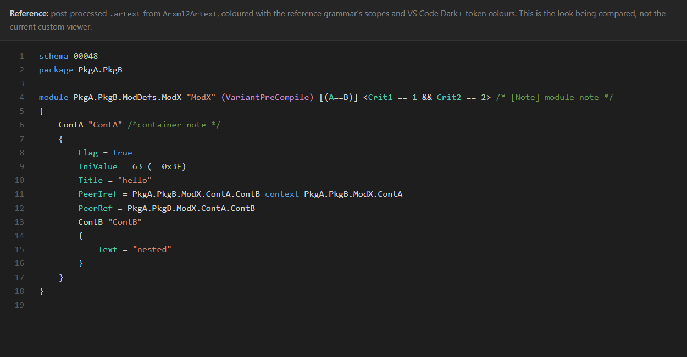
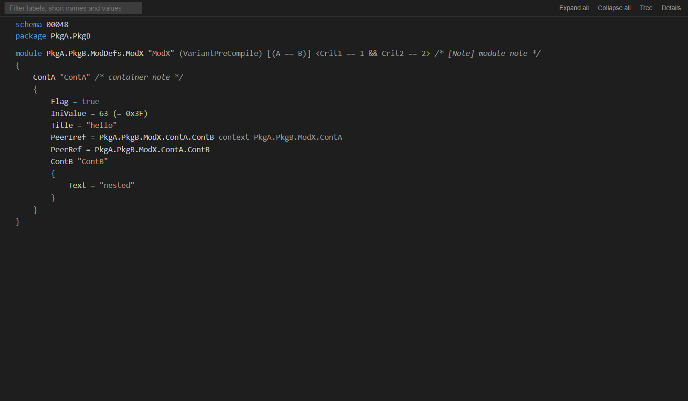
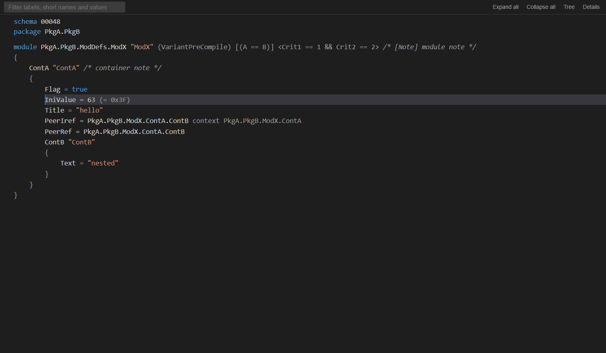
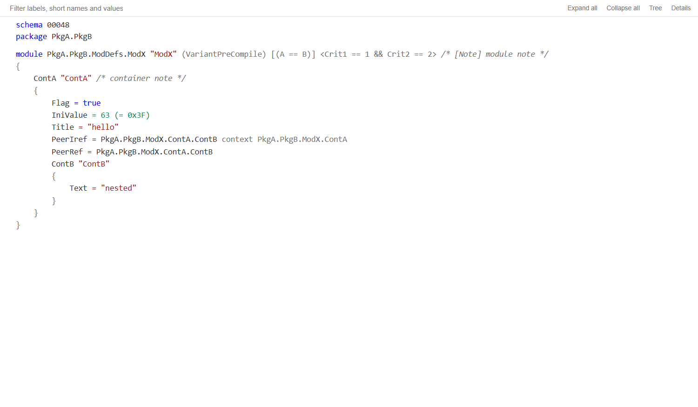
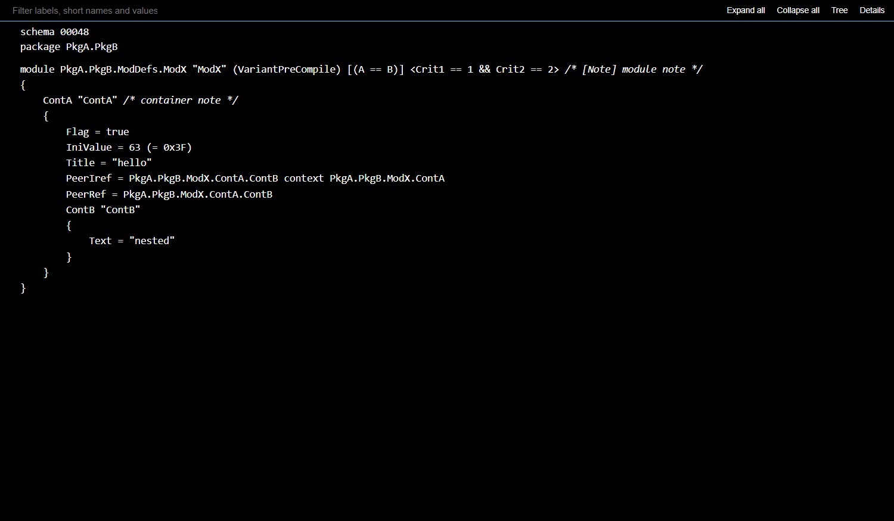
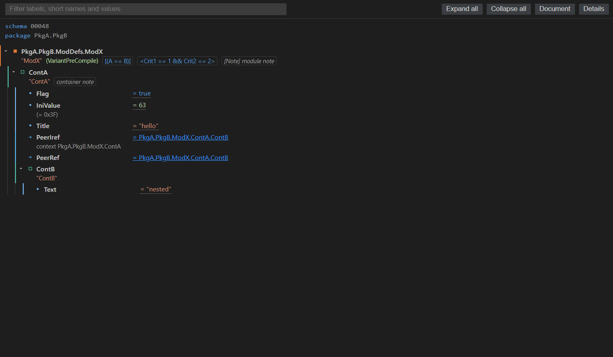

# ECUC Editor — design context and brief

> **What this document is for.** You are the **design agent**. Your job is to produce a **design
> specification** for the ECUC custom editor, not to edit production code. The implementation agent
> will take your spec and implement it in this repository.
>
> The requester's benchmark is the raw, syntax-highlighted `.artext` view shown below. The current
> editor is functional but still feels like a web widget next to that text. The goal is a design that
> feels as calm and readable as the ARTEXT reference while keeping the editor's real interactions.
>
> **Repository:** `D:\workspace\vscode-arxml-scope`
> **Branch:** `feat/arxml-scope`
> **Code baseline:** commit `d074185` (`feat(editor): make the ECUC document view read like an editor`)
> **Current state:** 160 tests passing; type-check, lint and the preview harness are green.
> **Images:** filesystem paths are relative to the repository root. Markdown image links are relative
> to this document, so `design/…` means `docs/design/…`.

---

## 1. The requester's brief

- The ECUC editor opens as a **Document view**: one ECUC entity per line, monospace, indentation,
  braces, inline metadata.
- The requester still finds it visually unsatisfying compared with the raw `.artext` file with syntax
  highlighting. The earlier chip-heavy Tree view was rejected outright; the editor-like pass was an
  improvement but not the final look.
- The requester explicitly chose an **editor-like, restrained-colour** direction: calm text surface,
  clear hierarchy, a small semantic palette, no web-form affordances.
- Specific dislikes to avoid:
  - chips, cards, per-row borders, fixed label columns, two-line metadata grids;
  - underlined values, including the `=` sign (`= 63`, `= true`, `= "hello"`);
  - bright blue underlined reference targets;
  - full-row list-selection bars;
  - heavy toolbars and large filter boxes;
  - a rainbow of one colour per entity kind.
- The requester wants the design to feel like **reading a source file**, not like a dashboard.
- Semantic colours are still wanted, but only where they carry meaning (keywords, strings, numbers,
  booleans, comments); structural names should be neutral.

The design agent should decide the visual system; the implementation agent will map it to the
existing webview. Do not change the information model or the interactions to make the design easier.

---

## 2. The ARTEXT reference look

This is the post-processed `.artext` output rendered with the reference TextMate grammar's scopes and
VS Code Dark+ token colours. It is a **look reference**, not a format to reintroduce.



The reference text is:

```text
schema 00048
package PkgA.PkgB

module PkgA.PkgB.ModDefs.ModX "ModX" (VariantPreCompile) [(A==B)] <Crit1 == 1 && Crit2 == 2> /* [Note] module note */
{
    ContA "ContA" /*container note */
    {
        Flag = true
        IniValue = 63 (= 0x3F)
        Title = "hello"
        PeerIref = PkgA.PkgB.ModX.ContA.ContB context PkgA.PkgB.ModX.ContA
        PeerRef = PkgA.PkgB.ModX.ContA.ContB
        ContB "ContB"
        {
            Text = "nested"
        }
    }
}
```

Token legend in the picture:

| Look | Reference scope | Meaning |
|---|---|---|
| Blue | `keyword.control.artext` / `constant.language.boolean` | `schema`, `package`, `module`, `context`, booleans |
| Yellow | `entity.name.function` | dotted entity paths (module, targets) |
| Teal | `entity.name.type` | label before a short name (`ContA`) |
| Orange | `string.quoted.double` | short names and string values |
| Green | `constant.numeric` / hex | schema release, numbers, `0x3F` |
| Purple | variant/condition scopes | `(VariantPreCompile)`, `[(A==B)]` |
| Green italic | comment | `/* [Note] module note */` |
| Grey | editor line number | the gutter |

Why it feels calmer than the current UI:

- one text surface, one baseline, no boxes around rows;
- a line-number gutter gives the text a clear left edge;
- colours are sparse and semantic; most names are neutral;
- values and targets are plain text, not underlined controls;
- the eye can scan indentation and braces, not borders and chips.

**Do not** propose parsing or writing `.artext`, running `mmx`, or adding a second renderer. The
reference exists only to judge the visual language.

Source: `.trellis/tasks/archive/2026-10/10-27-ecuc-viewer-document-redesign/research/reference-artext/display-rules-highlighted.html`.

---

## 3. The current UI baseline

### 3.1 Document view (default)









What it already does:

- editor font with a 14px fallback, 1.5 line height;
- a 3.5ch gutter for the hover-revealed twisty, 4ch child indentation;
- braces aligned with the parent row;
- neutral structural labels (module path, container, parameter, reference);
- semantic accents only for keywords, strings, numbers/hex, booleans and annotations;
- reference targets plain until hover;
- parameter values plain text, with no dotted underline or hover pencil;
- a compact document bar (3px padding, 240px filter, flat transparent buttons);
- a quiet editor line highlight for selection, plus a 2px left focus edge;
- one entity per line, long lines scroll horizontally.

What still feels unresolved:

- the bar is still a web toolbar, just slimmer; it competes with the document;
- the 3.5ch gutter is empty most of the time and does not read as an editor gutter;
- the text is very plain in the dark theme; hierarchy comes mostly from indentation;
- the selected line turns monochrome (editor foreground) instead of keeping syntax colours;
- the relationship between the Document view, Tree view and details panel is not visually designed;
- light/high-contrast themes are readable but not deliberately composed;
- deep nesting and long lines have no special treatment;
- there is no empty/loading/edge visual language beyond the filter's empty state.

### 3.2 Tree view (optional)



The Tree view is the original two-line grid: fixed 26ch label column, chips for variant/conditions/
annotations, per-kind inline-SVG glyphs and accent borders, dotted values and blue underlined targets.
It is deliberately retained because it is better for scanning dense hierarchies and for high-contrast
kind recognition. The design must say whether it stays visually as-is or is brought closer to the
Document language; do not remove it.

### 3.3 Details panel

The details inspector is a right-side panel, **hidden by default**. When shown it lists kind, primary
label, full `DEFINITION-REF`, short name/variant, value/hex, target/context, conditions, annotations,
source range, and actions (`Reveal in source`, `Copy path`, `Copy value`). It currently uses a
small-caps key/value hierarchy. Its content must stay; its presentation is open for design.

### 3.4 What the editor shows

| Entity | Fields |
|---|---|
| Schema | detected AUTOSAR release (`00048`) |
| Package | dotted package path |
| Module | `module` + full `DEFINITION-REF` path + short name + variant |
| Container | `DEFINITION-REF` tail + short name, nested to any depth |
| Parameter | `DEFINITION-REF` tail + value + hex form for numerics |
| Reference | `DEFINITION-REF` tail + target path + instance context |
| Conditions | `[SW-SYSCOND]` and `<criterion == value && …>` |
| Annotations | `[Label] text`, comment-style in Document view |

Everything must remain visible and searchable. The design may change hierarchy and spacing; it may
not hide fields to make the screen cleaner.

---

## 4. Product and interaction context

The extension is a VS Code custom editor for AUTOSAR ECUC-Values `.arxml` files. It parses the file
once in process, keeps source ranges, and writes only a parameter's `<VALUE>` text through a
`WorkspaceEdit`. It never claims `.arxml` by default (`priority: "option"`); it opens from the
command palette, the Explorer/editor context menu, or **Open With…**.

Interactions that must survive any design:

- click selects; the twisty collapses/expands; double-click or `Ctrl`/`Alt`+`Enter` reveals the
  source; clicking a reference target follows it;
- `Enter` toggles a container or reveals a leaf; `Space` selects; `F2` edits a parameter value;
- `Home`/`End`, `PageUp`/`PageDown`, arrow keys and type-ahead traverse the tree;
- filter by label, short name or value, with count, clear button and an empty state;
- collapse/expand all; filter/collapse/selection/scroll survive a re-scan;
- inline value editing with Enter/Escape/Tab, refused values keep the typed text and show a reason;
- details panel with reveal/copy actions;
- view and details preferences persist through the webview state.

Accessibility is a hard requirement: real `tree`/`treeitem`/`group` roles, `aria-level`,
`aria-expanded`, `aria-selected`, `aria-posinset`/`aria-setsize`, a roving `tabindex`, visible focus,
and readable light/dark/high-contrast themes.

---

## 5. Technical constraints the spec must respect

- **Plain HTML/CSS/JS in a VS Code webview.** No React/Vue, no CSS framework, no external stylesheet,
  no remote font or image. The whole page is a string template in `src/editor/renderHtml.ts`.
- **CSP:** `default-src 'none'; style-src 'nonce-…'; script-src 'nonce-…'`. Inline SVG is allowed;
  remote loads are not. A design that needs an asset file is not implementable as-is.
- **Theme variables only.** Every colour must be a `--vscode-*` variable with a fallback inside
  `var(...)`. Do not propose literal hex colours; the only existing literal is the indent-guide
  fallback `#80808040`. The webview must work in light, dark and high contrast.
- **One DOM, two views.** `body[data-view="document"]` and `body[data-view="tree"]` are CSS modes over
  the same tree markup. Document selectors are scoped. Do not propose a second renderer.
- **DOM contracts:** `.value` is a direct child of `.row`; the value widget's click/key listeners are
  registered first and claim their events with `stopImmediatePropagation`; `.row-meta` is the single
  rendered source for the details inspector's secondary fields; node ids and `matchRanges` are stable.
- **No new runtime dependency, asset or font.** No manifest priority change. No changes to
  `src/core/**` or the write path.
- **No `.artext` parsing or `mmx`.** The ARTEXT text is a visual reference only.
- **Performance:** 4,001 and 12,001-node synthetic samples load in the harness; no second render pass
  and no virtualisation in this design. Avoid designs that require per-row DOM duplication or heavy
  runtime layout.
- **Verification limits:** the browser harness (`npm run preview:ecuc`) is not a VS Code webview. It
  cannot prove VS Code's own theme resolution or real focus/font metrics. The design should be
  verifiable in the harness and call out what needs a real Extension Development Host check.

---

## 6. Where the design lands in the code

| Path | Role |
|---|---|
| `src/editor/renderHtml.ts` | **The UI.** `renderTree` markup, `renderHtml` shell, `STYLE`, `TREE_SCRIPT`, document/tree CSS, state script |
| `src/editor/ecucEditorProvider.ts` | Custom editor provider; webview lifecycle, messages, re-scan, selection, settings |
| `src/editor/ecucValueEditor.ts` | Inline value editor; event ownership and refusal handling |
| `src/editor/filter.ts` | Search fields, `matchRanges`, filter algorithm |
| `src/editor/navigation.ts` | Reveal/follow mechanics |
| `src/editor/nodeId.ts` | Stable node ids and index |
| `src/editor/ecucEdit.ts` | Build/apply the minimal `WorkspaceEdit` |
| `src/editor/clipboard.ts` | Copy actions |
| `src/core/ecuc/*` | Detection, scanner, model, ordering, resolution, validation — **do not change** |
| `src/core/text/offsets.ts` | Line/offset index |
| `scripts/preview-ecuc.js` | Browser preview harness; `?view=document|tree`, `?theme=light|dark|hc`, `?chrome=0` |
| `scripts/generate-samples.js`, `scripts/bench-ecuc.js` | Synthetic samples and Node benchmark |
| `src/test/editor/*`, `src/test/core/*` | Tests; 160 passing |
| `docs/ECUC_EDITOR.md` | User/developer documentation |
| `.trellis/spec/frontend/*` | Frontend conventions, DOM/theme/test rules |

### How a render happens

1. `ecucEditorProvider.resolveCustomTextEditor` gates the file (`isArxmlPath` / `isEcucValues`); a
   refused file falls back to the text editor before any HTML is set.
2. `scanEcucValues` parses the text once into an `EcucDocumentModel`; `buildNodeIndex` gives stable
   node ids and source ranges.
3. `renderHtml(model, { nonce, sort, lineIndex })` writes the complete page: the CSP nonce, the
   toolbar, `renderTree` markup, the details panel, and the inlined tree/filter/value-editor scripts.
4. The webview owns selection, collapse, scroll, filter, type-ahead, the open value edit, and the
   view/details preferences.
5. A re-scan calls `renderTree` and swaps only the `#tree` region; the shell, toolbar and inspector
   survive, and the page restores collapse/selection/scroll.
6. Edits, follows, reveals and copies are posted to the host; the host validates and writes through
   `WorkspaceEdit`, calls VS Code navigation, or uses the clipboard.

### Current document selectors and state

Useful hooks the spec can target:

```text
body[data-view="document"] #tree
body[data-view="document"] .meta                    schema/package header
body[data-view="document"] .row                     entity line
body[data-view="document"] .label                   structural name
body[data-view="document"] .value                   value / inline editor host
body[data-view="document"] .row-meta                short name, variant, hex, context, conditions, annotations
body[data-view="document"] .short / .variant / .hex / .context / .condition / .annotation / .target
body[data-view="document"] .children                child group; ::before/::after are the braces
body[data-view="document"] .twisty / .spacer        gutter controls
body[data-view="document"] .glyph                   hidden kind marker
body[data-view="document"] .toolbar / .filter / .count / .notice / .tool
#inspector                                          details panel
```

Node attributes: `data-node-id`, `data-kind="module|container|parameter|reference"`,
`data-value-kind="numeric|textual|boolean"`, `data-selected`, `data-follow`, `aria-expanded`,
`aria-level`, `aria-posinset`, `aria-setsize`.

Webview state: `{ view: "document" | "tree", inspectorHidden: boolean }`; defaults are Document and
hidden. Both persist via `getState()/setState()`.

---

## 7. Design brief: what to produce

Produce a **design specification** that the implementation agent can follow without guessing. It
should be a Markdown document plus static mockups or a small HTML/CSS prototype. Do not edit the
production source.

### 7.1 Direction

- State the visual direction in one or two paragraphs and 4–6 principles.
- Explain how it relates to the ARTEXT reference and what it deliberately changes.
- Resolve the tension: readable text document vs interactive tree/editor.

### 7.2 Layout

- The app shell: top bar vs bottom status bar vs auto-hide; where the filter, count, expand/collapse,
  View and Details actions live.
- The document surface: gutter, indentation, braces, line length, horizontal scrolling, padding.
- The details panel: side panel, overlay, or bottom sheet; empty and selected states; whether it
  squeezes the document or floats over it.
- The Tree view's place and visual relationship to Document view.
- Narrow-width behaviour (≤720px) and very wide behaviour.

### 7.3 Typography and spacing

- Font stack, size, line height, weights, letter spacing, tab/indent size.
- The exact vertical rhythm; row height; blank lines; header spacing.
- Alignment rules for labels, values, metadata, conditions, annotations, braces.
- How to keep long lines readable without wrapping or hiding fields.
- Deep nesting (six levels); how the gutter and indentation behave.

### 7.4 Colour and token system

- Light, dark and high-contrast palettes using `--vscode-*` variables with fallbacks.
- Token mapping: structural names, keywords, strings, numbers/hex, booleans, variants, conditions,
  annotations, reference targets, context.
- Selection, focus, hover, active, editing, invalid, filtered, flash/reveal.
- Contrast rules; selected-line treatment; high-contrast fallback.
- Whether to use per-kind colours at all, and if so, how to keep them restrained.

### 7.5 Components and states

At minimum:

- app bar / status bar;
- filter field, clear button, count badge, notice;
- module, container, parameter and reference lines;
- short name, variant, hex, context, condition, annotation;
- gutter twisty (collapsed/expanded/hover/focus);
- selected/focused/hovered/editing/invalid lines;
- reference target (default/hover/follow);
- details inspector (empty/selected, keys/values, action buttons);
- Tree view rows and chips;
- empty filter state;
- narrow width.

Provide a state matrix: default, hover, focus-visible, selected, editing, invalid, collapsed,
filtered. Include what changes and what must not.

### 7.6 Interaction and accessibility

- How selection, focus, hover and editing are communicated without list bars or underlines.
- Keyboard focus visibility; tree roles; aria; reduced motion; high contrast.
- How collapse/expand is discoverable without a permanent twisty column.
- How editability is discoverable without a dotted underline.
- How reference-follow is discoverable without a blue link.

### 7.7 Implementation mapping

- Exact CSS selectors/classes and any markup changes.
- Which current rules to replace/remove.
- Which variables and fallbacks to use.
- Any new state or attributes (prefer none).
- A "does not change" list: DOM contracts, state keys, interactions, core, write path, manifest.
- Performance implications and any risk.

### 7.8 Deliverable outline

Use this structure (or a better one, but cover every section):

```markdown
# ECUC Editor Design Spec

## 1. Direction and principles
## 2. Shell and layout
## 3. Typography and spacing
## 4. Colour and token system
## 5. Components and states
## 6. Interaction and accessibility
## 7. Responsive and density
## 8. Implementation mapping
## 9. Open questions / decisions
## 10. Acceptance checklist
```

Include annotated mockups or a static prototype for:

- Document view, dark;
- Document view, light;
- Document view, high contrast;
- Document view, selected/focused row;
- Document view, editing and invalid value;
- Tree view, dark;
- details panel, empty and selected;
- narrow width.

If you produce a prototype, use the existing theme variables or clearly named placeholders; do not
add remote assets. The implementation agent will translate it into `src/editor/renderHtml.ts`.

---

## 8. Open design questions

Answer these in the spec, with a recommendation:

1. **Toolbar:** keep a slim top bar, move actions to a bottom status bar, or auto-hide them? How does
   the filter stay discoverable?
2. **Line numbers:** should the document have a real line-number gutter? The braces are decorative
   pseudo-elements today; numbering only entity rows would misrepresent the file. If line numbers
   are wanted, say what structural change is acceptable.
3. **Gutter:** if there are no line numbers, how should the left margin earn its space? Twisties only
   on hover? A fold rail? A subtle rule?
4. **Colour:** how many accents, and which? Is the current neutral-label + semantic-value palette the
   right balance, or should labels get one restrained accent?
5. **Selection:** line highlight, text-only highlight, or a left rail? How to keep token colours
   readable on the selected line?
6. **Focus:** full outline, left edge, caret-like marker? Must survive high contrast.
7. **Editability:** how to show that a value is editable without an underline or pencil? Hover
   affordance, cursor, a small gutter marker, or a status hint?
8. **Reference follow:** how to make a target look actionable without a permanent blue underline?
9. **Details:** side panel, overlay, bottom sheet, or inline expansion? How to keep the document's
   full width while details are one click away?
10. **Tree view:** keep it as the technical view, or align it to the new visual language? It must
    remain available and recognisable.
11. **Density:** 13px vs 14px; line-height 1.5 vs 1.6; 4ch indentation vs 2ch; how dense should a
    12k-node file feel?
12. **Long lines:** horizontal scroll vs wrap vs a "soft wrap" toggle? The reference scrolls
    horizontally.
13. **Conditions/annotations:** comments, chips, or a quieter secondary style? They must stay
    readable and searchable.
14. **Empty/edge states:** filter empty, no ECUC values (falls back to text editor), long labels,
    missing variant, no annotations, CDATA-refused editing.
15. **Icons vs text buttons:** which actions deserve an icon, and how to keep them accessible?

---

## 9. Acceptance criteria for the design spec

The spec is ready to implement when:

- [ ] It covers Document view, Tree view, the toolbar, the details panel and narrow widths.
- [ ] It defines every state: default, hover, focus, selected, editing, invalid, collapsed, filtered,
      and reference-follow.
- [ ] It gives light/dark/high-contrast values using `--vscode-*` variables with fallbacks.
- [ ] It gives exact type sizes, line heights, spacing, indentation, alignment and colour intent.
- [ ] It maps each component to existing selectors/classes and lists any markup change.
- [ ] It respects the DOM contracts, state keys, interactions and accessibility requirements.
- [ ] It introduces no runtime dependency, asset, font, remote load, `.artext` parsing or core change.
- [ ] It includes annotated mockups/prototype and a visual comparison with the ARTEXT reference.
- [ ] It answers the open questions with recommendations.
- [ ] It includes a "do not change" list and an implementation-risk list.
- [ ] It can be implemented without inventing visual values during coding.

---

## 10. Verification and limits for the implementation

The implementation agent will run:

```bash
npm run check-types
npm run lint
npm test
npm run preview:check
```

and the browser harness:

```bash
npm run preview:ecuc
# http://127.0.0.1:4173/?fixture=sample/display-rules&theme=dark&chrome=0&view=document
# http://127.0.0.1:4173/?fixture=sample/display-rules&theme=dark&chrome=0&view=tree
```

Known limits to state honestly:

- The harness is not a VS Code webview; real theme resolution, editor font metrics, focus behaviour
  and host clipboard remain Extension Development Host checks.
- References are single-file; CDATA-backed values are not editable; structural editing is not
  supported; no virtualisation.
- The current line selection uses the editor foreground for contrast; token colours return when the
  selection moves. If the design keeps token colours on the selected line, specify a contrast-safe
  rule.
- The document currently scrolls long lines horizontally. A wrap proposal must handle the tree's
  indentation and editing widget.
- No synthetic line numbers today; see the open question.

---

## 11. Handoff back

When the design spec is ready, provide:

1. the Markdown spec (path or content);
2. the prototype/mockup files and any images;
3. a short "implementation order" list;
4. a "do not change" list;
5. any decisions that need the requester's approval before coding.

The implementation agent will then create the implementation task, wire the CSS/markup in
`src/editor/renderHtml.ts`, update the document tests and captures, run the gates, and keep the Tree
view, details panel, value editing, core parser and write path intact.
